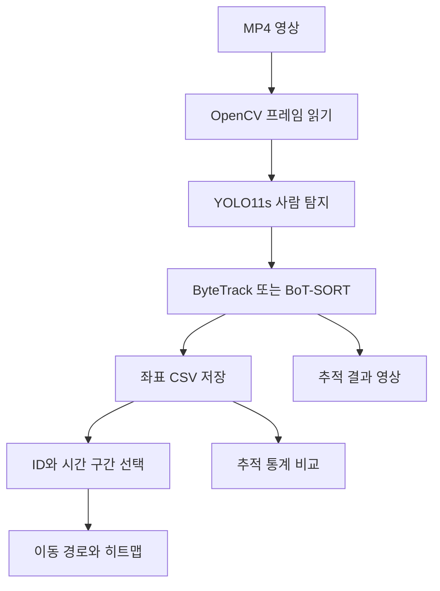
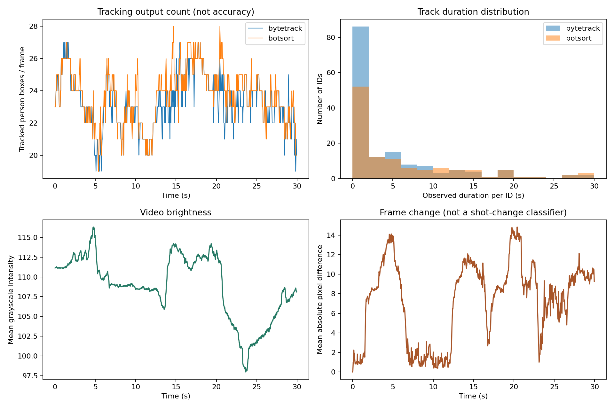
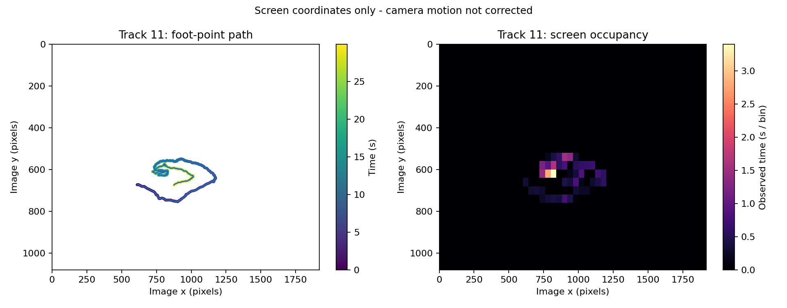
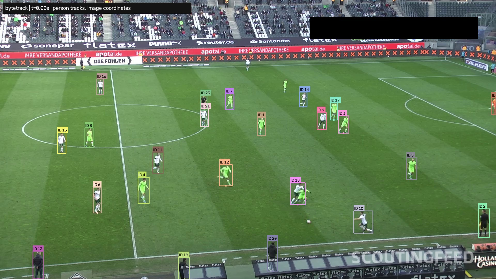
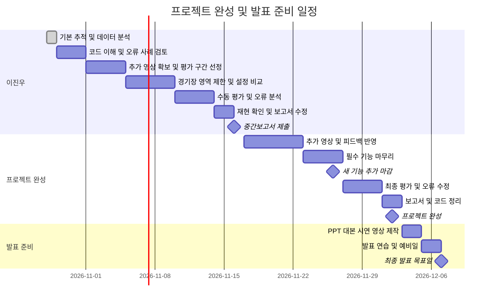

# 프로젝트 중간보고서

## 1. 프로젝트 개요

- **수행 학기:** 2026학년도 2학기
- **프로젝트명:** 축구 경기 영상 선수 추적 및 움직임 분석
- **작성일:** 2026년 10월 28일
- **지도교수:** 데이터 사이언스 학과 김정은 교수님

| 구분 | 성명 | 학번 | 소속학과 | GitHub 아이디 |
|---|---|---|---|---|
| 1 | 이진우 | 20242406 | 데이터 사이언스 학과 | ljw-0108 |

## 2. 프로젝트 내용

### 2.1 서론

평소 축구에 관심이 있어 컴퓨터 비전 기술을 축구 경기 영상에 적용해보고자 했다. 여러 선수가 동시에 움직이는 영상에서 사람의 위치를 자동으로 추적하고, 이를 데이터로 저장해 이동 경로와 활동 영역을 확인하는 것이 목표이다.

현재는 30초 샘플 영상에 YOLO11s와 두 종류의 추적기를 적용하고, 위치 CSV와 이동 경로·히트 맵을 생성하는 기본 과정을 구현했다. 일반 사전학습 모델을 사용했기 때문에 심판이나 경기장 밖 인물도 포함될 수 있다. 따라서 현재 결과는 **선수 추적 시스템을 만들기 위한 사람 탐지·추적 기준 실험**으로 본다.

### 2.2 추진 배경(자료조사 및 요구분석)

#### 2.2.1 개발 배경 및 필요성

축구 영상을 직접 보면서 선수마다 위치를 기록하려면 많은 시간이 필요하다. 짧은 영상에서도 특정 인물의 움직임을 선택해서 볼 수 있고, 위치 데이터를 다시 분석할 수 있으면 경기 장면을 이해하는 데 도움이 될 수 있다.

| 요구사항 | 구현 방향 |
|---|---|
| 영상 속 인물 위치 추적 | YOLO11s 탐지 후 추적 ID 부여 |
| 분석 데이터 재사용 | 프레임·시간·ID·신뢰도·좌표를 CSV 저장 |
| 특정 인물과 구간 조회 | ID와 시작·종료 시각을 지정하는 Python 명령 제공 |
| 움직임 시각화 | 이동 경로와 화면 좌표 히트 맵 생성 |
| 결과의 한계 확인 | 추적 공백과 좌표 보정 여부를 명시 |

#### 2.2.2 선행기술 및 사례 분석

- **Football Analysis Project[2]:** YOLO 기반 탐지·추적, 유니폼 색상 팀 구분, 카메라 이동 보정, 속도·거리 계산 등을 구현한 참고 프로젝트이다. 본 프로젝트는 기능 범위를 줄여 위치 데이터 저장, ID별 조회, 추적 결과 분석에 집중한다.
- **Ultralytics YOLO11[3]:** 사전학습 객체 탐지 모델을 제공한다. 이번에는 YOLO11s의 COCO 가중치를 사용했다. 선수와 심판을 따로 학습한 모델은 아니다.
- **ByteTrack[4]:** 낮은 신뢰도의 탐지 결과까지 연결에 활용하여 가림 상황의 추적 단절을 줄이려는 방식이다.
- **BoT-SORT[5]:** 움직임 정보와 카메라 움직임 보정 등을 사용하는 추적 방식이다. 이번 실행은 Ultralytics 기본 설정으로, 외형 기반 재식별은 꺼진 상태이다.

**차별성:** 탐지·히트 맵 자체를 새 기술로 제시하기보다, CSV를 통한 재분석, ID·시간 구간 선택, 추적 공백 확인을 연결하여 사용하기 쉬운 분석 흐름을 만드는 데 의미를 둔다. 현재 두 추적기의 출력 통계를 비교했으며, 정확도 개선 여부는 정답 데이터 확보 후 검증할 예정이다.

**관련 특허 조사:** 공개 문헌 US20260187816A1[6]은 중계 영상에서 추적 가능한 프레임을 선정하고, 경기장·자세 정보와 카메라 보정, 짧은 추적 구간 연결을 이용하는 구성을 설명한다. 중계 영상 분석이라는 목적은 유사하지만 본 중간 구현에는 자세 기반 보정이나 미래 움직임 예측이 없다. 분석 가능한 장면을 구분한다는 관점을 참고했으며, 공개 내용만으로 자유 이용 가능 여부나 권리 비침해를 판단하지 않았다.

### 2.3 목표 및 내용

#### 2.3.1 제안 목표 대비 진행 상황 및 수정 목표

**제안 목표와 현재 진행 상황**

| 제안서의 목표 | 지금까지 수행한 작업과 근거 | 달성 상태 |
|---|---|---|
| 30초~1분 영상의 선수 탐지·추적 | 30초 영상 750프레임에 YOLO11s와 두 추적기를 실행하고 결과 영상 생성 | 부분 달성: 사람 추적은 구현했으나 선수·심판 구분은 미완료 |
| 프레임별 위치 좌표 저장 | ByteTrack 17,455행, BoT-SORT 17,809행의 시간·ID·좌표 CSV 생성 | 기본 기능 달성: 좌표는 선수만이 아닌 추적된 사람의 위치 |
| 이동 경로·히트 맵 생성 | ID 11의 30초 이동 경로·히트 맵, ID·시간 구간 선택 기능 구현 | 화면 좌표 기준 달성: 경기장 좌표 보정은 미완료 |
| 3~5개 영상에서 동작 확인 | 공개 샘플 영상 1개 분석 | 미 달성: 추가 영상과 독립 평가 필요 |
| 팀 분류 등 확장 기능 | 관련 방법 조사 | 미 구현: 기본 기능 검증 이후 선택적으로 진행 |

제안 목표 중 **위치 데이터 저장과 이동 경로·히트 맵 생성의 기본 기능에 대한 실제 결과**를 확보하였다. 이는 아직 정확한 선수 분석을 완성했다는 의미는 아니지만, 영상에서 추출한 정보를 재사용 가능한 데이터로 만드는 과정이 동작함을 보여준다.

**목표 달성 가능성에 대한 자체 평가**

핵심인 ‘짧은 영상 입력 → 추적 → CSV 저장 → ID별 시각화’는 현재 구현되어 있어, 입력 조건을 제한하고 추가 영상에서 검증하면 최종 결과물로 완성할 가능성이 높다고 판단한다. 다만 사람 탐지를 선수 탐지로 정제하고 동일 인물을 안정적으로 유지하는 과정은 추가 검증이 필요하다. 현재의 고유 ID 수와 관측 시간만으로 정확도를 평가할 수 없으며, 움직이는 카메라 영상에서 실제 경기장 활동 영역을 계산하는 일은 개인 프로젝트의 남은 기간에 비해 난도가 높다.

**실험을 바탕으로 조정한 목표**

| 항목 | 기존 목표·고려 범위 | 수정한 목표 | 조정 이유 |
|---|---|---|---|
| 분석 결과 | 선수의 움직임과 활동 영역 분석 | 화면 좌표 기준 이동 경로·히트 맵을 필수 결과로 확정 | 카메라 이동 보정이 없어 현재 좌표를 실제 경기장 위치로 해석할 수 없음 |
| 위치 기준 | 바운딩 박스 중심점 저장 | 중심점과 하단 중앙점을 모두 저장 | 발 위치 근사와 추후 경기장 좌표 변환에 활용하기 위함 |
| 데이터 수 | 3~5개 영상 | 중간 제출까지 최소 2개, 최종 단계에는 최소 3개를 목표로 함 | 현재 확보한 영상이 1개이며 수동 오류 점검 시간도 필요함 |
| 선수 구분 | 자동 선수 탐지 | 경기장 영역 제한과 대표 선수 수동 점검을 우선 수행 | 일반 person 모델이 심판·경기장 밖 인물도 포함함 |
| 성능 확인 | 탐지·추적 동작 확인 | 같은 평가 구간에서 누락·ID 변경을 수동 점검하고 처리 시간도 기록 | 고유 ID 개수만으로 추적 정확도를 판단할 수 없음 |
| 확장 기능 | 팀 분류, 공·점유율 분석, 비전 에이전트 등 검토 | 핵심 검증 이후 선택 기능으로 분리 | 필수 결과물의 완성도와 분석 근거 확보에 시간을 집중하기 위함 |

#### 2.3.2 개발 내용

**시스템 구성**

**현재 구현한 기능**

- 영상 FPS를 자동으로 읽어 시간 계산과 결과 영상 저장에 적용
- 전체 프레임 순차 추적, 박스·ID·신뢰도·좌표 저장
- ID별 관측 시간, 같은 ID 내부의 추적 공백 계산
- ID·시간 구간을 지정해 CSV와 그래프를 출력하는 명령형 조회
- 누락 구간을 선으로 연결하지 않는 이동 경로 시각화
- 비교 그래프 및 ID가 표시된 결과 영상 생성

**데이터셋 및 전처리**

| 항목 | 이번에 실제 사용한 데이터 |
|---|---|
| 출처 | Football Analysis Project에 연결된 공개 샘플 영상[2] |
| 파일 수 | 1개, `sample.mp4` |
| 영상 형식·크기 | MP4, 1920×1080 |
| 길이·FPS | 30초, 25 FPS |
| 전체 프레임 | 750프레임, 생략 없이 처리 |
| 파일 용량 | 20.34 MB(십진 기준) |
| 모델 입력 | `imgsz=640`, 비율을 유지한 리사이즈·패딩 |
| 대상 클래스 | COCO `person` 1개, 클래스 번호 0 |
| 라벨·학습 | 별도 정답 라벨 없음. 신규 학습·미세조정 수행 안 함 |
| 데이터 분할 | 단일 개발용 영상이며 독립 평가 데이터는 아직 없음 |

원본 영상은 RGB 컬러 영상이며 OpenCV에서는 BGR 배열로 읽는다. 이번에는 SoccerNet을 내려받거나 학습에 사용하지 않았다. 영상 확보 목표는 중간 제출까지 최소 2개, 최종 단계 최소 3개로 조정했으며 추가 확보와 평가는 앞으로 진행할 작업이다.

**데이터 탐색 결과**

- ByteTrack이 반환한 사람 박스의 원본 영상 기준 높이 중앙값은 **62.7px**, 10백분위수는 **46.4px**였다. 탐지된 박스에 한정된 통계이지만 입력 축소 시 작은 객체의 세부 정보가 줄어드는 문제를 보여준다.
- 프레임별 평균 밝기는 **98.0~116.3** 범위였다. 320×180 축소 회색 영상의 전체 평균이며 경기장 밝기만을 측정한 값은 아니다.
- 첫 결과 이미지에서 선수 외에 심판·경기장 밖 인물도 추적되는 것을 확인했다. 경기장 영역 제한과 선수 분류가 필요하다.
- 0초·약 6초·15초·30초의 대표 프레임에서 화면의 경기장 배치와 선수 크기가 달라지는 것을 확인했다. 이 영상은 고정 카메라 영상으로 취급하지 않는다.
- 프레임 차이 값을 계산했지만 카메라 이동과 선수 움직임도 영향을 주므로 장면 전환 판정에 바로 사용하지 않았다.

#### 2.3.4 개발 환경

| 항목 | 실제 실험 환경 |
|---|---|
| 운영체제 | Linux x86_64 원격 실행 환경 |
| CPU | Intel Xeon Platinum 8573C, PyTorch 계산 스레드 2개 |
| GPU | 사용하지 않음(CPU 추론) |
| Python | 3.12.14 |
| PyTorch | 2.5.1+cpu |
| Ultralytics | 8.3.221 |
| OpenCV | 5.0.0.93 |
| 데이터 분석 | Pandas 2.2.3, NumPy 2.3.5 |
| 시각화 | Matplotlib 3.10.8 |

탐지 설정은 `conf=0.1`, `iou=0.7`, `imgsz=640`, `classes=[0]`으로 동일하게 사용했다. 추적기는 각각 기본 YAML 설정을 사용했으며 실제 설정 파일을 결과 폴더에 포함했다. 속도는 각 추적기를 순차적으로 한 번씩 실행한 값으로, 사용자 PC의 성능을 의미하지 않는다.

#### 2.3.5 결과

**실제 실행 결과 비교**

| 항목 | ByteTrack | BoT-SORT |
|---|---:|---:|
| 분석 프레임 | 750 | 750 |
| 좌표 CSV 행 수 | 17,455 | 17,809 |
| 고유 추적 ID 수 | 152 | 115 |
| 프레임당 평균 추적 박스 | 23.27 | 23.75 |
| 1초 미만 관측된 ID 수 | 73 | 40 |
| ID별 관측 시간 중앙값(초) | 1.12 | 3.00 |
| 같은 ID 내부의 공백 프레임 합계 | 425 | 525 |
| 추론·추적 처리 속도(FPS) | 6.01 | 2.92 |
| 영상 읽기·그리기·저장 포함 시간(초) | 148.57 | 279.19 |

- 각 실험의 ID 번호는 독립적으로 부여되므로, 두 실험의 같은 번호를 같은 인물로 대응시키지 않았다.
- 고유 ID 수는 실제 선수 수나 ID switch 횟수가 아니다. 신규 등장, 재등장, 추적 단절, 경기장 밖 인물 등이 함께 영향을 준다.
- 공백 프레임은 같은 ID의 최초·마지막 관측 사이에서 값이 없는 프레임이다. 실제 인물이 보였는지 확인하지 않았으므로 미탐지율로 부르지 않는다.
- 처리 FPS는 사전 워밍업 후 탐지·추적 호출 시간 기준이다. 전체 시간에는 영상 읽기·그리기·원시 영상 저장을 포함하며 사후 그래프 생성과 동영상 압축은 제외한다.
- 정답 라벨이 없어 mAP, IDF1, HOTA, 정확한 ID 변경 횟수는 측정하지 않았다. 두 방식의 정확도 우열은 아직 결론 내릴 수 없다.

이번 영상에서는 BoT-SORT의 고유 ID 수(115개)와 1초 미만 관측 ID 수(40개)가 ByteTrack(각각 152개, 73개)보다 적었다. 반면 같은 ID 내부의 공백 합계는 525프레임으로 ByteTrack의 425프레임보다 많았고, 탐지·추적 처리 속도도 약 2.92 FPS로 ByteTrack의 6.01 FPS보다 느렸다. 한 지표만으로 우수한 방식을 선택하기 어렵기 때문에 다음 단계에서는 실제 인물의 ID 유지 여부를 직접 확인할 예정이다.

**ID별 움직임 분석**

ByteTrack 결과에서 관측 횟수가 가장 많은 ID 중 번호가 가장 작은 **ID 11**을 자동 선택했다. 이 ID의 관측 수는 **750프레임**, 관측 시간은 **30.00초**였다. 이동 경로와 48×27 격자의 시간 누적 히트맵을 생성했다. 관측 시간이 길다는 사실만으로 같은 실제 선수를 끝까지 정확히 추적했다고 판단하지는 않는다.

카메라 이동을 경기장 기준으로 보정하지 않았기 때문에 위 결과는 **영상 좌표 기준**이다. 실제 경기장 활동 영역, 미터 단위 이동거리, km/h 속도로 해석하지 않는다. BoT-SORT의 추적용 움직임 보정이 이러한 경기장 좌표 변환을 대신하지도 않는다.

**현재 결과가 전체 프로젝트에서 가지는 의미**

이번 결과는 단순히 탐지 박스를 표시하는 단계를 넘어, 위치 정보를 CSV로 저장하고 원하는 ID와 구간을 다시 분석하는 흐름을 확인했다는 점에서 의미가 있다. 생성된 CSV·그래프·코드는 다음 실험에서 같은 방식으로 재사용할 수 있다. 또한 두 추적기의 결과 차이와 선수 외 인물 포함 문제를 확인하여, 향후 작업의 우선순위를 ‘기능 추가’보다 ‘선수 영역 정제와 추적 검증’에 두게 되었다.

**현재 완료 여부**

| 작업 | 상태 |
|---|---|
| 30초 영상 확보 및 기본 특성 확인 | 완료 |
| YOLO11s와 두 추적기 실행 | 완료 |
| 위치 CSV·ID별 통계 저장 | 완료 |
| 명령형 ID·시간 구간 조회 | 완료 |
| 이동 경로·화면 좌표 히트맵 | 완료 |
| 선수·심판·경기장 밖 인물 구분 | 미구현 |
| 경기장 좌표 보정 및 실제 거리 계산 | 미구현 |
| 정답 라벨을 이용한 정확도 평가 | 미실시 |
| 여러 영상 평가·웹 화면·비전 에이전트 | 향후 작업 |

**발견한 문제와 개선 방향**

1. **짧은 추적 구간이 많음:** ByteTrack에서 1초 미만 관측된 ID가 73개였다. 잘못 탐지된 인물, 재등장, ID 단절 여부를 대표 장면에서 수동 점검할 예정이다.
2. **선수 외 인물 포함:** 경기장 영역 마스크와 유니폼 정보를 이용한 필터링을 검토한다.
3. **카메라 움직임의 영향:** 고정 장면부터 경기장 기준점을 지정하고, 이동·줌이 바뀌는 경우 보정 방법을 추가한다.
4. **정답 데이터 부족:** 개발 영상과 다른 평가 영상을 확보하고 일부 구간에 선수 박스와 실제 ID를 표시한다.

### 2.4 기대효과

선수 위치를 직접 기록하는 작업을 줄이고, 특정 구간의 움직임을 CSV와 그래프로 확인하는 데 도움이 될 수 있다. 학습 측면에서는 객체 탐지 결과를 데이터 분석으로 연결하고, 결과의 신뢰도와 한계를 판단하는 경험을 얻을 수 있다. 현재는 교육용 프로토타입으로, 전문 경기 분석 시스템 수준의 정확도를 주장하지 않는다.

### 2.5 범위·일정 조정 및 향후 계획

**범위 재평가**

필수 결과물은 짧은 영상의 추적 결과 영상, 위치 CSV, ID·시간 구간 선택 기능, 화면 좌표 이동 경로·히트맵, 오류 분석 보고서로 한정한다. 실시간 처리는 필수 조건으로 두지 않고 저장된 영상을 순차 분석하는 방식으로 진행한다. 이는 이번 CPU 실험의 탐지·추적 처리 속도가 약 2.92~6.01 FPS로 원본 25 FPS보다 느렸기 때문이다.

경기장 좌표 보정은 고정 카메라 장면의 기준점 설정부터 선택적으로 시도한다. 이동 카메라 전체 보정, 실제 거리·속도 계산, 팀·공·점유율 분석, 웹 화면과 비전 에이전트는 핵심 기능 검증 후 여유가 있을 때 진행한다. 선택 기능을 완료하지 못하더라도 화면 좌표 기준이라는 한계를 명시한 필수 결과물을 제출한다.

**12월 7일까지의 단계별 계획**

수업 PDF의 중간보고서 제출일인 **2026년 11월 16일**을 유지하고, 준비 마감인 **12월 7일을 최종 발표 목표일**로 설정하였다. 실제 발표일이 별도로 공지되면 발표 날짜만 조정한다. **11월 26일에 새 기능 추가를 마감하고, 12월 2일까지 검증·보고서·코드 정리를 완료한 뒤 12월 3~6일은 발표 준비에 집중**한다. 아래 내용은 향후 계획이며 완료 실적이 아니다

| 기간 | 수행할 작업 | 완료 확인 기준 |
|---|---|---|
| 10/29~10/31 | 코드 이해, 원본 영상과 추적 결과 대조 | 주요 함수 설명 및 대표 오류 사례 정리 |
| 11/1~11/4 | 다른 영상 최소 1개 확보, 개발·평가 구간 구분 | 총 2개 이상 영상의 출처·길이·FPS 기록 |
| 11/5~11/9 | 경기장 영역 제한, 추적 설정 비교 | 동일 구간에서 적용 전후 결과와 설정값 저장 |
| 11/10~11/13 | 수동 평가와 오류 분석 | 평가 영상의 10초 구간에서 보이는 선수 3명 이상을 선정해 누락·ID 변경 기록 |
| 11/14~11/15 | 결과 재현 확인, 보고서 수정 | 표의 수치와 CSV 일치, 코드 실행 및 이미지 경로 확인 |
| 11/16 | 중간보고서 제출 | 학번·GitHub 정보와 수업 제출 조건 최종 점검 |
| 11/17~11/22 | 추가 영상 확보와 중간 피드백 반영 | 총 3개 이상 영상 확보, 기존 1개는 개발용·추가 2개는 평가용으로 구분 |
| 11/23~11/26 | 필수 기능 마무리와 선택 기능 검토 | ID·시간 조회, CSV·그래프·결과 영상 정상 출력. 11/26 새 기능 추가 마감 |
| 11/27~11/30 | 설정을 고정한 최종 평가와 오류 수정 | 평가용 영상에서 두 추적기의 누락·ID 변경·속도 비교표와 대표 실패 사례 확보 |
| 12/1~12/2 | 최종 보고서·코드·실행 안내 정리 | 재실행 확인, 결과 파일 정리, 프로젝트 완성본 저장 |
| 12/3~12/4 | 발표 자료와 시연 영상 제작 | 문제·방법·결과·한계·개선 방향을 담은 PPT, 대본, 30~60초 시연 영상 |
| 12/5~12/6 | 발표 연습 및 예비일 | 발표 시간에 맞춘 리허설 2회 이상, 예상 질문 답변과 백업 파일 준비 |
| 12/7 | 최종 발표 목표일 | 발표 및 결과물 제출 준비 완료 |

수동 평가는 실제 인물이 화면에 보이는 프레임을 기준으로 한다. 화면 밖으로 나간 시간을 미탐지로 세지 않고, 판단하기 어려운 가림 구간은 따로 기록한다. 개발용 구간에서 설정을 조정하고, 평가용 구간은 설정을 고정한 뒤 비교한다. 이 소규모 점검 결과를 전체 경기의 정확도로 일반화하지 않는다.

**일정 지연 시 조정 기준**

- 우선순위는 데이터 출처 정리, 선수 후보 추적, CSV 저장, ID별 조회·시각화, 오류 분석이다.
- 경기장 좌표 보정은 고정 장면부터 시도하되, 11월 26일까지 안정화하지 못하면 최종 필수 범위에서 제외하고 화면 좌표 분석의 한계를 설명한다.
- 팀 분류·공 탐지·점유율·웹 화면·비전 에이전트는 선택 기능이다. 핵심 평가가 늦어지면 추가하지 않는다.
- 12월 3일 이후에는 치명적인 오류만 수정하고 발표 준비 시간을 확보한다. 시연 실패에 대비해 사전 실행 영상과 CSV·그래프를 준비한다.

**발표 구성 계획**

발표는 주제 선정 이유, 전체 처리 과정, 실제 데이터와 실험 조건, 추적기 비교 결과, 이동 경로·히트맵 시연, 한계와 개선 방향 순서로 구성한다. 발표 시간은 교수님 공지에 맞춰 조정한다. 탐지 수·고유 ID 수를 정확도로 설명하지 않고, 구현한 기능과 미구현 기능을 구분하여 답변한다.

### 2.6 역할 분담

| 구분 | 성명 | 역할 |
|---|---|---|
| 1 | 이진우 | 자료조사, 데이터 확보, 코드 이해·수정, 실험 검토, 오류 분석, 보고서 및 발표 준비 |

### 2.7 참고문헌

1. abdullahtarek, [Football Analysis Project](https://github.com/abdullahtarek/football_analysis), GitHub. [실험 샘플 영상](https://drive.google.com/file/d/1t6agoqggZKx6thamUuPAIdN_1zR9v9S_/view), 확인일 2026-10-28.

2. Ultralytics, [YOLO11](https://docs.ultralytics.com/models/yolo11/), [Tracking 문서](https://docs.ultralytics.com/modes/track/), 

3. Yifu Zhang 외, [ByteTrack: Multi-Object Tracking by Associating Every Detection Box](https://arxiv.org/abs/2110.06864), 2021/2022.

4. Nir Aharon 외, [BoT-SORT: Robust Associations Multi-Pedestrian Tracking](https://arxiv.org/abs/2206.14651), 2022.
5. Long Sha 외, [System and method for generating player tracking data from broadcast video](https://patents.google.com/patent/US20260187816A1/en), US20260187816A1,.

